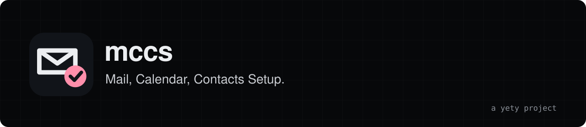

<div align="center">

<a href="https://www.yety.ch"></a>

<h3>A white-label wizard that walks your users through setting up mail, calendar and contacts on their own devices.</h3>

<a href="https://www.yety.ch">Website</a> · <a href="docs/index.md">Documentation</a> · <a href="https://github.com/yetysw/mccs/releases">Releases</a>

[](LICENSE)

</div>

## Overview

mccs stands for Mail, Calendar, Contacts Setup.

mccs is a web page you host for the customers of your mail service. They type their address, pick Windows, macOS, iPhone, iPad or Android, and get a short guide with every value ready to copy.

- **One step per screen.** Outlook, Thunderbird, Apple Mail, Gmail, Samsung apps, CalDAV Synchronizer and DAVx5, with the right server settings filled in.
- **Yours, not ours.** Name, logo, accent colour, servers and support contact come from environment variables. Nothing about your instance lives in the code.
- **No passwords.** It never asks for one, stores nothing and sets no cookies.

Free, for good. MIT licence, no paid edition.

## Quick start

No image is published yet, so Docker builds it from the repository:

```bash
git clone https://github.com/yetysw/mccs.git && cd mccs
cp .env.example .env      # set MAIL_HOST, PUBLIC_URL, BRAND_NAME
docker compose up -d --build
```

1. Open http://localhost:8080 and try the wizard with an address on your domain.
2. Put it behind an HTTPS reverse proxy for production: see [Reverse proxy and HTTPS](docs/reverse-proxy.md).
3. Set `SUPPORT_PASSWORD` to turn on the internal `/support` page that builds pre-filled links and QR codes.

Nothing is stored on disk, so there is nothing to back up except your `.env`. To upgrade: `git pull && docker compose up -d --build`.

## Features

- Guided wizard: address, device, app, then a step-by-step guide with copyable values.
- Guides for Outlook (new and classic), CalDAV Synchronizer, Thunderbird, Apple Mail, Gmail, Samsung apps and DAVx5.
- One-tap Apple configuration profile (`.mobileconfig`, without password) and Thunderbird autoconfig.
- QR code on a computer to continue on a phone.
- Internal `/support` page (HTTP Basic) that builds a link for one customer, with QR code, PNG or SVG export and a ready-made email or SMS text.
- Presets: `mdaemon` (default, MDaemon WebDAV paths and shared "[Public]" folders) or `generic` (standard `.well-known` discovery), with URL templates to override either.
- Dark and light theme that follow the system, mobile friendly, strict Content-Security-Policy.

Every variable, endpoint and guide option is in the [documentation](docs/index.md).

## Architecture

One Node 22 process using only the built-in `http` module, with no npm dependency. The front end is plain HTML, CSS and JavaScript served from memory. The browser reads its settings from `/api/config`. Everything comes from environment variables, in a read-only container running as a non-root user.

## Limits

- The interface and the guides are in French. Translating means editing `public/js/guides.js`, `public/js/app.js` and the HTML files by hand.
- The Apple profile is not signed. iOS and macOS show "Not signed" when installing it, and the server does not sign it for you.
- The guides describe third-party apps as they look today. A new version of Outlook or Thunderbird can make a step out of date.
- The server settings are only as right as your configuration: it does not check that your mail server answers.
- The `/support` lock-out keys on the `CF-Connecting-IP` header when present, so only expose the app behind a proxy that controls it.
- No published image, no automated tests and no CI yet.

## Status

Early. The guides were written for one MDaemon instance and the `generic` preset has had less use. Variable names and endpoints can still change before 1.0.
Formerly called Mail Setup; the repository was `config-auto-messagerie`.

## Contributing

Bug reports, guide fixes and presets for other servers are welcome: see [CONTRIBUTING.md](CONTRIBUTING.md). Security issues: [SECURITY.md](SECURITY.md).

## License

MIT, see [LICENSE](LICENSE). mccs is provided "as is", without warranty of any kind. Checking that the settings it shows are right for your servers is up to you.

## Support mccs

mccs is free. If it saves you time, you can support its development:

[Sponsor us on GitHub](https://github.com/sponsors/yetysw), recurring or one-off.
